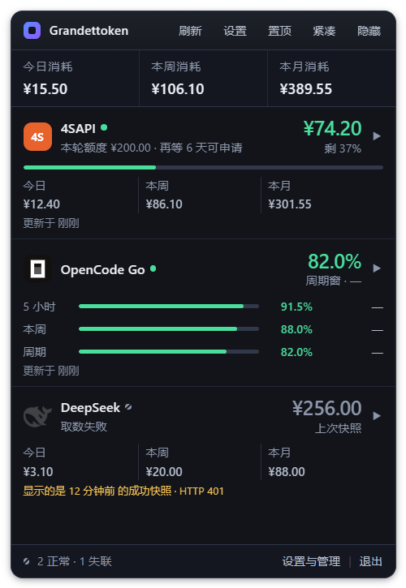

<div align="center">

# Grandettoken

**常驻 Windows 桌面的多平台 AI Token 余额与用量监控小组件**

看一眼托盘,就知道哪个 API Key 快没钱了。

</div>



四种折叠形态,从一屏全览到 8px 竖条贴边:面板 → 紧凑条 → 胶囊 → 吸附屏幕边缘。
下面是同一次取数的另外两种形态:

| 紧凑条 | 胶囊 |
|---|---|
|  |  |

> 截图由 `build/shot-panel.js` 用**仿真数据**截取 —— 界面上看到的是真实渲染路径,
> 但数字是编的。脚本截完会把真实配置写回去(逐字段核对一致才算还原)。

---

## 这是什么

同时用多个 AI 服务的开发者,余额散在四五个网页控制台里。单渠道的告警邮件容易被忽略,
为了看一眼余额去开四个网页更麻烦。Grandettoken 把这些余额搬到桌面上:

- **9 个内置渠道**,金额型 / 配额型 / 积分型三种口径分开渲染
- **四级折叠**,最忙的时候收成一条 8×64 的竖条贴在屏幕边缘,鼠标移入才展开
- **跌破红线发系统通知**,只在跌破的那一刻响一次、一天最多一次
- **取数失败绝不渲染成"余额归零"** —— 沿用上次成功快照 + 标注时间 + 真实错误原因
- **密钥只进 Windows 凭据管理器**,不进配置文件、数据库、日志或导出文件
- 无遥测、无云同步,出网请求只发往渠道自身域名

顺带两件事:**模型页**能把选中的模型一键写进本机的 Trae / WorkBuddy / WorkBuddy AI /
ZCode / DeepSeek Harness(写入前备份、写完读回校验、失败自动回滚);
**每日签到**能替你去领 Trae / WorkBuddy / Qoder 的积分(**默认开**,可在设置里逐渠道关掉)。

## 下载

去 [Releases](https://github.com/wacilimonster-source/Grandettoken/releases/latest) 下
**NSIS 安装包**(per-user,装到 `%LOCALAPPDATA%\Grandettoken`,**不需要管理员权限**)。

装了之后点「检查更新」就能收到新版 —— 更新走
`releases/latest/download/latest.json`,该地址永远指向最新可用版。
数据与密钥都在安装目录之外,**覆盖安装、升级、重装都不丢**。

```
installer   Grandettoken_<版本>_x64-setup.exe
签名       Grandettoken_<版本>_x64-setup.exe.sig
更新清单   latest.json
```

三个文件都要从 Release 里下到,少一个自动更新链路就断。

## 支持哪些渠道

| 渠道 | 类型 | 说明 |
|---|---|---|
| **4SAPI** | 金额型 · 申请制 | 积分制,500000 积分 = ¥1;分母是**单次额度**(默认 ¥200),不是累计发放 |
| **OpenCode Go** | 配额型 | $10/期包月,**未公开接口**只回百分比,不折算金额也不参与合计 |
| **DeepSeek** | 金额型 · 充值型 | 充值型,无月限额,不画进度条 |
| **Hapi** | 金额型 · 充值型 | 积分制,20 积分 = ¥1 |
| **Trae** | 积分型 | 每笔积分各有到期日,重点显示"哪一笔什么时候过期" |
| **WorkBuddy** | 积分型 | 读桌面端凭据(含 refresh 续期),没装桌面端时回落到网页会话 |
| **Codex** | 配额型 | ChatGPT 后端内部接口,5 小时 / 周 / 月三个限流窗口 |
| **Qoder** | 积分型 | 国际版;读桌面端凭据,每日 10:00(UTC+8)刷新 |
| **Qoder 国内版** | 积分型 | 与上一行是**两套账号**,不互通;国内站 `qoder.cn` |

还有**自定义渠道**:填一个地址、字段路径和换算倍数,就能接任何没内置支持的中转站
余额接口(测试通过才让保存)。

### 两条口径要记住

**百分比和金额不能相加。** 配额型渠道(OpenCode Go / Codex)只给已消耗百分比,
所以不画进度条、不参与底部消耗合计,行内换成三个限流窗口的剩余量。

**充值型渠道的消耗是推算值。** DeepSeek / Hapi 的接口只返回当前余额,不含累计消耗;
今日 / 本周 / 本月消耗由本地 SQLite 快照的余额差值算出:

```
consumption(t0,t1) = Σ max(0, remaining[i-1] - remaining[i])
```

负差值(充值、配额重置)按 0 算。**代价是程序未运行的时段会形成数据空洞,数字偏小** ——
界面上会标"推算",缺口超过 10 分钟还会标"数据自 X 起"。窗口起点没有基线时显示
"—— / 数据不足",**绝不把缺失数据渲染成"没花钱"或"已耗尽"**。

### 取数不消耗 token

四个接口都是账务 / 元数据接口,不是推理接口 —— 查询余额不产生任何 token 计费。
所以可以放心定时轮询,唯一约束是对方的限流礼貌性。

| 场景 | 间隔(默认,可在设置里改) |
|---|---|
| 面板展开 | 1 分钟 |
| 折叠 / 托盘 | 5 分钟 |
| 连续失败 3 次后 | 退避到 15 分钟 |

带 5 秒抖动,避免多渠道同秒并发。

## 安全与隐私

| 项 | 做法 |
|---|---|
| 密钥 | 界面明文输入,落盘写入 **Windows 凭据管理器**(服务名 `TokenScope`),由当前 Windows 账户的登录凭据保护 |
| 密钥**永不** | 写入 JSON、SQLite、日志或导出文件 —— 配置文件可以随便备份或分享 |
| 网络 | 请求只发往渠道自身域名。无遥测、无云同步、无账号体系 |
| 数据库 | `%APPDATA%\com.wacil.tokenscope\tokenscope.db`(本地 SQLite,90 天明细 + 365 天归档) |
| 体检报告 | 逐渠道真打一次接口 + 本机四项检查,结果可复制的纯文本 —— 里面只有域名、状态与数值,**没有任何密钥** |

## 已知边界(不是 bug,是设计或上游限制)

- **OpenCode Go 的接口未公开**,无稳定性保证,响应结构一变该渠道就显示取数失败
  (渠道定义里标了 `unstable`,界面上可与稳定渠道区分)。
- **OpenCode Zen 的按量付费 credits 余额没有公开接口**,只能在网页控制台查看。
- **写入客户端配置要求目标进程不在运行** —— 它们的配置是内存态落盘,边跑边写会被覆盖
  (Trae 的 SQLite 还可能写坏)。DeepSeek Harness 是唯一例外:它按请求解析配置,
  所以是"下一个请求生效"而不是"先退出"。
- **备份里含明文密钥**。回滚要靠备份,备份就是照原样拷目标客户端那几个文件,
  而那些文件里的密钥本来就是明文。所以每次写入会留下含明文密钥的历史快照
  (每个客户端最多 5 份,换密钥后旧快照不会自动失效,卸载也不清这些目录)。
  界面的写入预告里必须把这句话说出来 —— 这是本功能最大的信任成本,不藏。
- **没有降级通道**。更新插件判断依据是"线上版本号 > 当前版本号",把 `latest.json`
  指回旧版本号不会让任何人降级。发坏了只能删 release 或转 prerelease 止损,
  然后发一个版本号更高的修复版。

## 从源码构建

```powershell
.\build\install-toolchain.ps1    # 一次性:装 Rust GNU 工具链 + MinGW(免管理员)
.\build\build.ps1 test           # 跑 227 个单元测试
.\build\build.ps1 build          # 出 release 二进制
.\build\build.ps1 bundle         # 出 NSIS 安装包
```

工具链装在用户目录,不需要管理员权限。Windows 上走系统 SChannel 做 TLS,
避免 rustls 的 ring/aws-lc 汇编依赖在 GNU 工具链下需要 nasm 的问题;
exe 静态链接 WebView2 加载器,单文件交付。

CI 在每次 push 上跑 core 的 `cargo test` 与 `cargo check --all-targets`;
打 `v*` tag 会自动构建、签名、发 Release 并生成 `latest.json`。

## 文档

| 文档 | 内容 |
|---|---|
| [DESIGN.md](DESIGN.md) | 产品设计:定位、渠道模型、形态系统、信息架构、已开发功能清单 |
| [PROGRESS.md](PROGRESS.md) | 开发进展与踩坑记录(按版本倒序,含全量体检的问题清单与修法) |
| [app/README.md](app/README.md) | 开发者向:模块划分、加新渠道 / 新客户端的步骤、内部口径 |
| [RELEASE.md](RELEASE.md) | 发版流程、签名私钥、更新链路硬依赖、回滚预案 |
| [docs/design/](docs/design/) | 21 份设计稿(交互可点的 HTML,含每项的裁决记录) |
| [docs/report/](docs/report/) | 5 份全量体检报告(每轮体检抓到的缺陷、根因、修法与复测证据) |
| [docs/prototype/](docs/prototype/) | 视觉原型稿与三形态按钮对照 |
| [docs/research/](docs/research/) | 技术研究(Codex 渠道接入取证) |

文档里带日期的 HTML 是当时的设计稿 / 体检报告,**记录的是"那一刻的判断与证据"**,
后续实现可能已经变了 —— 已实现的口径以 `DESIGN.md` 为准。

## 技术栈

| 项 | 选择 | 理由 |
|---|---|---|
| 框架 | Tauri 2 | release exe 约 8.5 MB、常驻内存约 40 MB;Electron 同功能约 100 MB / 200–300 MB |
| 逻辑层 | 独立 crate `tokenscope-core` | 不依赖 Tauri / WebView2,`cargo test` 秒级跑完 |
| 前端 | 纯静态 HTML/CSS/JS | 无打包器、无 `node_modules`,CSP 只放行自身 |
| HTTP | reqwest + native-tls | 走系统 SChannel;rustls 的 ring/aws-lc 在 GNU 工具链下要 nasm |
| 数据库 | rusqlite(bundled) | 单文件 SQLite,存用量快照 |
| 密钥 | Windows 凭据管理器 | keyring + windows-native |

## 许可证

[MIT](LICENSE) —— 保留版权声明,可自由使用 / 参考 / 分发。

> 产品早期叫 TokenScope,后改名 Grandettoken。仓库里的凭据服务名、bundle identifier
> (`com.wacil.tokenscope`)与部分文档标题仍沿用旧名 —— 那是为了不破坏已装用户的
> 更新链路与凭据条目,不是笔误。
