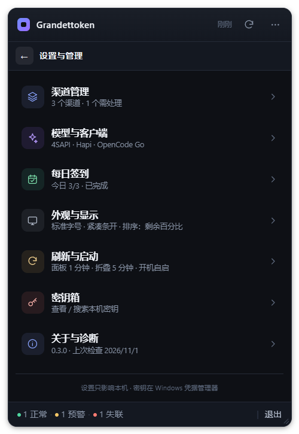

<div align="center">

# Grandettoken

**常驻 Windows 桌面的多平台 AI Token 余额与用量监控小组件**

看一眼托盘,就知道哪个 API Key 快没钱了。

</div>



三种常驻形态,从一屏全览到 8px 竖条贴边:面板 → 胶囊 → 吸附屏幕边缘。
另有一个**可选的紧凑条**(380×46 横条,默认关):在设置 → 显示里打开「启用紧凑条」后,
用 `Ctrl+2` 切换。标题栏固定四枚入口(刷新 / 置顶 / 隐藏 / 胶囊),不再有弹出菜单。
下面是同一次取数的另外两种形态:

| 紧凑条(可选) | 胶囊 |
|---|---|
|  |  |

> 截图由 `build/shot-panel.js` 用**仿真数据**截取 —— 界面上看到的是真实渲染路径,
> 但数字是编的。脚本截完会把真实配置写回去(逐字段核对一致才算还原)。

---

## 这是什么

同时用多个 AI 服务的开发者,余额散在四五个网页控制台里。单渠道的告警邮件容易被忽略,
为了看一眼余额去开四个网页更麻烦。Grandettoken 把这些余额搬到桌面上:

- **13 个内置渠道**，金额型 / 配额型 / 积分型三种口径分开渲染
- **三级折叠**,最忙的时候收成一条 8×64 的竖条贴在屏幕边缘,鼠标移入才展开;需要再省地方时可在设置里启用紧凑条
- **面板可缩放**:拖动窗口四边或四角调整大小(360×480 – 760×940),宽到 720 自动变两列;页脚常驻「↺ 默认大小」,点击回到 400×580(设置 → 显示也有入口)
- **标题栏固定四枚入口** —— 刷新 / 置顶 / 隐藏 / 胶囊;退出只保留在底栏与托盘,设置页改为「索引 → 子页」,380px 下不再挤页签
- **跌破红线发系统通知**,只在跌破的那一刻响一次、一天最多一次
- **取数失败绝不渲染成"余额归零"** —— 沿用上次成功快照 + 标注时间 + 真实错误原因
- **密钥只进 Windows 凭据管理器**,不进配置文件、数据库、日志或导出文件
- 无遥测；可选同步到手机（默认关闭，只写你自己的 GitHub secret gist，端到端加密）；除渠道接口、用户配置的端点和 GitHub 外，汇率换算会请求 open.er-api.com 或 api.frankfurter.dev，AI 优惠列表来自 www.aipromonow.com

WorkBuddy 桌面凭据取数会以 `ELECTRON_RUN_AS_NODE=1` 启动本机已安装的客户端，读取其内部存储以解开登录凭据。超时时用系统 `taskkill /T /F` 终止本次启动的子进程树。Qoder 桌面凭据由当前 Windows 账户通过 DPAPI 解开 Electron safeStorage 密钥后读取。在渠道设置中隐藏对应渠道可停止该渠道的自动取数与签到。

顺带两件事:**模型页**能把选中的模型一键写进本机的 Trae / WorkBuddy / WorkBuddy AI /
ZCode / DeepSeek Harness(写入前备份、写完读回校验、失败自动回滚);
**每日签到**能替你去领 Trae / WorkBuddy / Qoder / MiniMax 的积分(**默认开**,可在设置里逐渠道关掉)。

## 下载

去 [Releases](https://github.com/wacilimonster-source/Grandettoken/releases/latest) 下
**NSIS 安装包**(per-user,装到 `%LOCALAPPDATA%\Grandettoken`,**不需要管理员权限**)。

装了之后点「检查更新」就能收到新版 —— 更新走
`releases/latest/download/latest.json`,该地址永远指向最新可用版。
数据与密钥都在安装目录之外,**覆盖安装、升级、重装都不丢**。
Qoder 的逐笔到期明细另用挂件内的网页会话；升级不会主动清除此会话，但平台会话可能失效，
此时需在对应区域的渠道卡重新登录。桌面端余额凭据与网页会话彼此独立。

```
installer   Grandettoken_<版本>_x64-setup.exe
签名       Grandettoken_<版本>_x64-setup.exe.sig
更新清单   latest.json
```

三个文件都要从 Release 里下到,少一个自动更新链路就断。

## 支持哪些渠道

| 渠道 | 类型 | 说明 |
|---|---|---|
| **4SAPI** | 金额型 · 申请制 | 积分制,500000 积分 = ¥1;分母是**单次额度**(默认 ¥200),不是累计发放 |
| **OpenCode Go** | 配额型 | $10/期包月,**未公开接口**只回百分比,不折算金额也不参与合计 |
| **DeepSeek** | 金额型 · 充值型 | 充值型,无月限额,不画进度条 |
| **Hapi** | 金额型 · 充值型 | 积分制,20 积分 = ¥1 |
| **Gemini · Google Cloud** | 金额型 · 赠金 | 主动登录 Google Cloud 后读取结算账号剩余赠金，逐笔到期时间手填；本版在线取数待验收 |
| **Trae** | 积分型 | 每笔积分各有到期日,重点显示"哪一笔什么时候过期" |
| **WorkBuddy** | 积分型 | 读桌面端凭据(含 refresh 续期),没装桌面端时回落到网页会话 |
| **Codex** | 配额型 | 收起同显周与 5 小时额度（周优先）,展开查看准确重置时间、重置卡数量与逐卡到期日 |
| **Qoder** | 积分型 | 国际版;读桌面端凭据,每日 10:00(UTC+8)刷新 |
| **Qoder 国内版** | 积分型 | 与上一行是**两套账号**,不互通;国内站 `qoder.cn` |
| **MiniMax** | 积分型 | 读 MiniMax Code 桌面端凭据(`~/.minimax`,明文文件);逐笔到期积分 + 每日签到;免费积分每天发、30 天到期 |
| **豆包工作** | 积分型 | doubao.com 网页会话(挂件内登录窗捕获,不落盘;也可手动粘贴 Cookie 自救);体验额度读数(自动签到已于 v0.3.47 移除:服务端拒绝直连领取,连官方客户端都报错,复盘见 `docs/report/doubao-checkin-710010702-2026-11-14.md`) |
| **Antigravity** | 配额型 | 官方 `agy` 状态栏回调识别当前账号与配额；账号分别成卡，历史账号保留最后记录；主数字锁定 Gemini 周池，可展开其他分组；先在官方客户端完成登录 |

还有**自定义渠道**:填一个地址、字段路径和换算倍数,就能接任何没内置支持的中转站
余额接口(测试通过才让保存)。

### 两条口径要记住

| **百分比和金额不能相加。** 配额型渠道(OpenCode Go / Codex / Antigravity)只给已消耗/剩余百分比,
所以不画进度条、不参与底部消耗合计,行内换成三个限流窗口的剩余量。

**充值型渠道的消耗是推算值。** DeepSeek / Hapi 的接口只返回当前余额,不含累计消耗;
今日 / 本周 / 本月消耗由本地 SQLite 快照的余额差值算出:

```
consumption(t0,t1) = Σ max(0, remaining[i-1] - remaining[i])
```

负差值(充值、配额重置)按 0 算。**代价是程序未运行的时段会形成数据空洞,数字偏小** ——
界面上会标"推算",缺口超过 10 分钟还会标"数据自 X 起"。窗口起点没有基线时显示
"—— / 数据不足",**绝不把缺失数据渲染成"没花钱"或"已耗尽"**。

### 取数不消耗 token

四个接口都是账务 / 元数据接口,不是推理接口 —— 查询余额不产生任何 token 计费。
所以可以放心定时轮询,唯一约束是对方的限流礼貌性。

| 场景 | 间隔(默认,可在设置里改) |
|---|---|
| 面板展开 | 1 分钟 |
| 折叠 / 托盘 | 5 分钟 |
| 连续失败 3 次后 | 退避到 15 分钟 |

带 5 秒抖动,避免多渠道同秒并发。

## 本地模型网关

设置 → 本地模型网关 → 添加上游渠道 → OpenAI 兼容。按上游选择 **Chat Completions** 或 **Responses**。
只提供 `/v1/responses` 的上游可以填写 Base URL（例如 `https://agentrouter.org/v1`），选择密钥箱条目，
并在高级选项中填写模型 ID（例如 `gpt-6.1-sol`）。Responses 渠道填写手动模型后使用这份清单，可直接保存。
点击「测连通」或「模型与联调」可实际验证请求，联调可能消耗上游额度。

客户端使用 OpenAI Chat Completions（`POST /v1/chat/completions`），Base URL 填
`http://127.0.0.1:18771/v1`，密钥使用界面复制的**网关密钥**，模型填完整 ID，例如 `ar/gpt-6.1-sol`。
网关为 Responses 上游双向转换多轮消息、JSON、SSE 和函数工具调用。Responses 渠道支持单个候选输出，
会跳过没有直接对应字段的 `stop`、`top_k`、惩罚参数、`seed` 和 `logit_bias`，可在诊断中查看。
后续请求根据客户端提交的 Chat 消息历史重建上下文，Responses 特有的加密推理状态不在这份历史中。
停止网关可关闭监听，启用局域网时必须使用网关密钥。联调面板显示首字耗时、帧数、工具调用与 token 用量，
上游返回空流或零输出时给出诊断说明；请求进行中可随时取消。

进阶能力（对标 Magpie 本地网关最佳实践）：
- **虚拟路由组与预首字切备（`group/<id>`）**：支持 `order`（顺序优先）、`rotate`（轮询）、`expiring`（优先消耗 7 天内临期积分与 DeepSeek 北京时间谷时渠道）与 `pace`（优先剩余额度比例最高渠道），同一会话按 SHA-256 摘要（仅驻留内存，不留明文）保持 Sticky 上游命中与 Prompt Cache 前缀稳定；上游在首字节前返回 429/5xx/超时时按 `Retry-After`（上限 600s、无头默认按组冷却）自动冷却并无缝切换到下一候选。
- **Anthropic Messages 双协议入口**：同步暴露 `/v1/messages` 与 `/v1/messages/count_tokens`，可将 Claude Code 等客户端请求双向转译至 OpenAI Chat / Responses 渠道或虚拟路由组。
- **本地 SQLite 用量与缓存账本（`gateway_usage_log`）**：统计 1/7/30 天请求数、缓存命中率、P50/P95 首字耗时、切备次数与按 4SAPI 公开价目表估算费用（保留 90 天，仅记元数据、绝不落库 Prompt/响应/密钥正文，可一键清空）。
- **客户端「通过本地网关接入」与可选 Prompt 脱敏**：模型页与网关「接入与安全」支持向 `Trae` / `WorkBuddy` / `WorkBuddy AI` / `ZCode` / `DeepSeek Harness` / `Claude Code` / `Codex` / `OpenCode` 仅写入 `127.0.0.1` 回环地址与本地网关令牌，真实上游 API Key 始终留在 Windows 凭据管理器中；请求前 Sticky Prompt 脱敏**默认关闭**。

## 安全与隐私

### Google Cloud 赠金渠道

设置 → 渠道管理 → Gemini · Google Cloud → 连接 Google Cloud，主动登录并选择结算账号。
赠金页面需显示全部记录并清除过滤条件。渠道显示状态为可用的赠金余额，每笔到期时间可手动填写或清除，
时间按界面标明的本机时区解释。金额沿用结算币种，余额是结算账号共享额度，适用范围见每笔赠金说明。

连接后通过独立 WebView2 窗口读取 `console.cloud.google.com` 的赠金表格，后台按折叠刷新间隔更新。
Google 登录会话由本机 `google-cloud-profile` 浏览器配置保存；应用只提取结算账号、赠金标识、名称、
状态、金额及适用范围，不把 Cookie 或令牌搬进 SQLite、日志或同步载荷。
表格结果通过本机拦截并取消的 `grandettoken.invalid` 导航桥交给应用。
隐藏渠道或点击「停止连接」即可停止后台读取。停止连接保留本机登录及历史赠金记录，重新连接可复用登录。
页面结构变化、登录失效或过滤条件导致读取不完整时保留旧余额并显示失败；手填日期到期后显示到期状态，
金额由下一次 Google 页面刷新核对。

本版按代码与模拟页面测试交付，真实 Google 登录后的在线取数仍待验收。

| 项 | 做法 |
|---|---|
| 密钥 | 界面明文输入,落盘写入 **Windows 凭据管理器**(服务名 `TokenScope`),由当前 Windows 账户的登录凭据保护 |
| 密钥**永不** | 写入 JSON、SQLite、日志或导出文件 —— 配置文件可以随便备份或分享 |
| 同步凭据 | GitHub OAuth token 存 Windows 凭据管理器;同步载荷端到端加密后才写入你自己的 secret gist |
| 网络 | 请求只发往渠道自身域名;可选同步只发往你自己的 GitHub。无遥测;应用本身无账号体系,同步使用你自己的 GitHub 授权 |
| 数据库 | `%APPDATA%\com.wacil.tokenscope\tokenscope.db`(本地 SQLite,90 天明细 + 365 天归档) |
| 体检报告 | 逐渠道真打一次接口 + 本机四项检查,结果可复制的纯文本 —— 里面只有域名、状态与数值,**没有任何密钥** |
| MiniMax 凭据 | 读本机 MiniMax Code 客户端的**明文**登录文件(`~/.minimax/auth/prod/<区域>/mcode-public/auth.json`,与其它客户端登录态同一信任级别)。**令牌托管默认开**:MiniMax 的 access token 只有约 1 小时寿命,临近过期时挂件自动续期,并把轮换后的新令牌**原子回写**进同一份文件(保留 `generation` 字段,不会让客户端误判"在别处登录过")。设置 → 刷新与启动 → 「MiniMax 凭据」可关;关掉即**只读模式**(不刷新也不回写,令牌过期后渠道显示"需重新登录")。也可用环境变量 `MINIMAX_NOWRITEBACK=1` 硬关。令牌只进内存与该文件本身,不进日志(排查日志只记长度 + 指纹前 8 位) |
| Antigravity CLI | 启用渠道后，以 Windows 隐式 ConPTY 临时会话调用本机官方 `agy`，通过单次 `--settings` 配置官方 `statusLine` 回调，取得同一会话的账号身份与配额；过程保持空输入。回调用系统 PowerShell 在内存解析白名单，仅保存邮箱指纹、额度和采集时间。带 `AGY_CLI_DISABLE_AUTO_UPDATE=true`、`BROWSER=NUL` 与独立空临时目录，完成或超时后通过 Job Object 清理整棵子进程树。成功、失败和手动刷新共用至少 120 秒启动冷却。CLI 路径支持自动探测及手填。历史账号显示最后快照。隐藏账号卡冻结其记录并保留当前会话识别，隐藏整个 Antigravity 分组后停止 CLI 采集。第三方查询受 [Google 服务条款](https://antigravity.google/terms) 约束，账号风控风险仍存在 |
| Claude Code / Codex / OpenCode 配置写入 | 与既有客户端注入同一安全边界（`app/core/src/inject_cli.rs`）：必须用户主动点击预览确认才写入，配 **Windows DPAPI 加密备份**（新建文件记录 `existed=false`，回滚时自动删掉），保注释局部合并 `~/.claude/settings.json`、`~/.codex/config.toml`、`~/.config/opencode/opencode.jsonc|.json|config.json` 后再原子替换与读回校验；选「通过本地网关接入」时外部文件只写入 `127.0.0.1` 地址与网关访问令牌，**绝不写入真实上游 API Key**。目标在跑时**不拒写但强制二次确认**并提示重启/新会话生效（对齐 magpie）；预览会显示「它现在跑在什么上」（只读登录态存在性与账号标识，不读令牌值）；断开/卸载时按值级 stash 还原用户原 model/provider（stash 只存非密钥值，存 `%APPDATA%\com.wacil.tokenscope\inject-stash.json`）；卸载钩子（NSIS PREUNINSTALL 调 `--cleanup-inject`）摘除指向已消失网关的托管块。Claude Code 写顶层 `model`+分层 env、**不写 `ANTHROPIC_MODEL`**（它压掉 /model 选择）；Codex 托管表一旦写过就保留（旧线程靠它打开）；检测到 `CLAUDE_CODE_USE_BEDROCK/VERTEX/…` 云开关时拒绝接入（BASE_URL 会被忽略） |
| Sticky Prompt 脱敏与网关台账 | Request 级 Prompt 脱敏**默认关闭**（`MaskingSettings.enabled = false`）；仅当用户在「网关 → 接入与安全」显式开启时，才在内存中按会话做占位符映射并在响应 JSON / 跨分片 SSE 流还原，映射表随 TTL 清理，**绝不写入数据库或排查日志**。本地 SQLite 表 `gateway_usage_log` 仅保存时间戳、渠道/模型名、状态码、耗时、Token 数（含缓存命中/思考 Token）、估算费用与按入站 User-Agent 归因的 agent 名（**仅展示、不作鉴权，UA 可伪造**），保留 90 天并支持一键清空 |

## 已知边界(不是 bug,是设计或上游限制)

- **OpenCode Go 的接口未公开**,无稳定性保证,响应结构一变该渠道就显示取数失败
  (渠道定义里标了 `unstable`,界面上可与稳定渠道区分)。
- **OpenCode Zen 的按量付费 credits 余额没有公开接口**,只能在网页控制台查看。
- **写入客户端配置要求目标进程不在运行** —— 它们的配置是内存态落盘,边跑边写会被覆盖
  (Trae 的 SQLite 还可能写坏)。DeepSeek Harness 是唯一例外:它按请求解析配置,
  所以是"下一个请求生效"而不是"先退出"。
- **备份快照是加密的,但解密钥绑在当前 Windows 账户上**。回滚要靠备份,而目标客户端
  那几个配置文件里的密钥本来是明文 —— 所以每份快照都用 Windows DPAPI 加密后才落盘
  (密钥由系统账户托管,不进配置文件、不需要你记密码);升级前留下的旧明文快照会在
  下一次写入时自动加密。代价:**换了 Windows 账户或重装系统后,旧快照无法解密**
  (那种情况下用户目录本身也不在了)。每个客户端最多留 5 份,卸载不清这些目录,
  快照是密文,**手动把文件拷回去无效**,请用模型页的「一键回滚」;想清掉去「打开配置目录」。
  界面的写入预告必须把这件事说出来 —— 不藏。
- **MiniMax 的积分 / 签到接口非公开**(账务端点按官方客户端协议带签名访问),
  响应结构一变该渠道就显示取数失败。账号按凭据目录分区域(cn / io / com),
  哪个目录里有登录态就走哪套域名,同一台机器只认先找到的一个。
- **没有降级通道**。更新插件判断依据是"线上版本号 > 当前版本号",把 `latest.json`
  指回旧版本号不会让任何人降级。发坏了只能删 release 或转 prerelease 止损,
  然后发一个版本号更高的修复版。

## 从源码构建

```powershell
.\build\install-toolchain.ps1    # 一次性:装 Rust GNU 工具链 + MinGW(免管理员)
.\build\build.ps1 test           # 跑 core 单元测试(数量以 cargo test 输出为准,不写死)
.\build\build.ps1 build          # 出 release 二进制
.\build\build.ps1 bundle         # 出 NSIS 安装包
```

工具链装在用户目录,不需要管理员权限。Windows 上走系统 SChannel 做 TLS,
避免 rustls 的 ring/aws-lc 汇编依赖在 GNU 工具链下需要 nasm 的问题;
exe 静态链接 WebView2 加载器,单文件交付。

CI 在每次 push 上跑 core 的 `cargo test` 与 `cargo check --all-targets`;
打 `v*` tag 会自动构建、签名、发 Release 并生成 `latest.json`。

## 文档

| 文档 | 内容 |
|---|---|
| [DESIGN.md](DESIGN.md) | 产品设计:定位、渠道模型、形态系统、信息架构、已开发功能清单 |
| [PROGRESS.md](PROGRESS.md) | 开发进展与踩坑记录(新条目追加在文末;v0.3.50 之前的条目已原样归档到 `docs/report/progress-archive-2026-11-22.md`) |
| [app/README.md](app/README.md) | 开发者向:模块划分、加新渠道 / 新客户端的步骤、内部口径 |
| [RELEASE.md](RELEASE.md) | 发版流程、签名私钥、更新链路硬依赖、回滚预案 |
| [docs/design/](docs/design/) | 设计稿(交互可点的 HTML,含每项的裁决记录) |
| [docs/report/](docs/report/) | 体检报告(每轮体检抓到的缺陷、根因、修法与复测证据) |
| [docs/prototype/](docs/prototype/) | 视觉原型稿与三形态按钮对照 |
| [docs/research/](docs/research/) | 技术研究(Codex 渠道接入取证) |

文档里带日期的 HTML 是当时的设计稿 / 体检报告,**记录的是"那一刻的判断与证据"**,
后续实现可能已经变了 —— 已实现的口径以 `DESIGN.md` 为准。

## 技术栈

| 项 | 选择 | 理由 |
|---|---|---|
| 框架 | Tauri 2 | Windows 安装包大小见对应 Release；运行内存包含 WebView2 子进程 |
| 逻辑层 | 独立 crate `tokenscope-core` | 不依赖 Tauri / WebView2,`cargo test` 秒级跑完 |
| 前端 | 纯静态 HTML/CSS/JS | 无打包器、无 `node_modules`,CSP 只放行自身 |
| HTTP | reqwest + native-tls | 走系统 SChannel;rustls 的 ring/aws-lc 在 GNU 工具链下要 nasm |
| 数据库 | rusqlite(bundled) | 单文件 SQLite,存用量快照 |
| 密钥 | Windows 凭据管理器 | keyring + windows-native |

## 许可证

[MIT](LICENSE) —— 保留版权声明,可自由使用 / 参考 / 分发。

> 产品早期叫 TokenScope,后改名 Grandettoken。仓库里的凭据服务名、bundle identifier
> (`com.wacil.tokenscope`)与部分文档标题仍沿用旧名 —— 那是为了不破坏已装用户的
> 更新链路与凭据条目,不是笔误。
